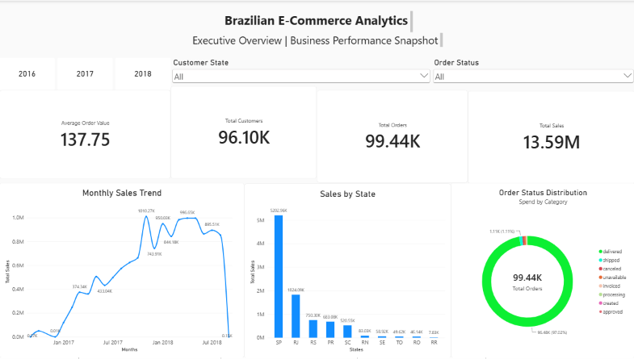
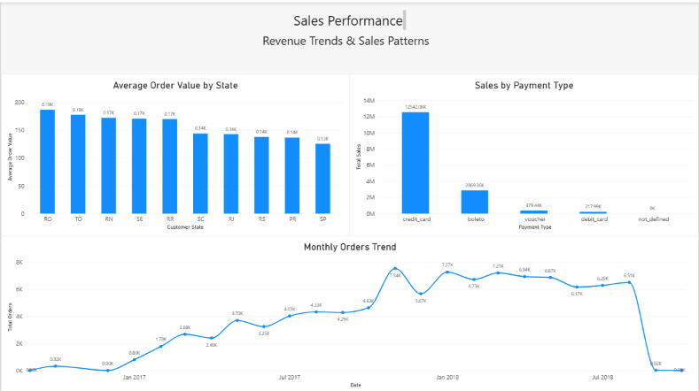
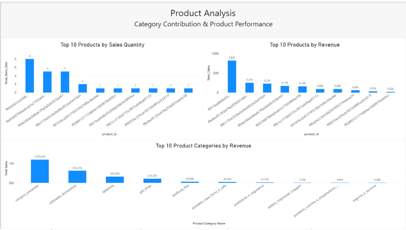
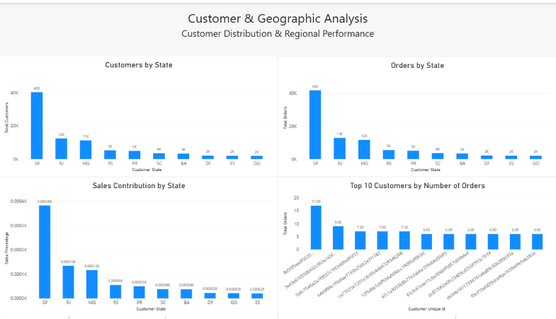
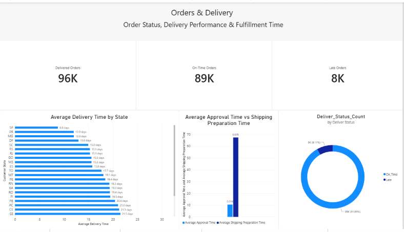

# Brazilian E-Commerce Data Analysis | Olist Analytics

## Project Overview

This project analyzes the Brazilian E-Commerce Public Dataset by Olist to explore sales performance, customer behavior, product performance, and order delivery operations.

Covering the period from 2016 to 2018, the dataset provides insights into e-commerce transactions and related business operations. Python is used for data preparation, exploratory data analysis, and business metrics, while Power BI is used to develop an interactive dashboard for business reporting.

The project follows a structured analytics workflow, from data loading and cleaning to business analysis, visualization, and business recommendations.

## Business Objectives

The main objectives of this project are to:

- Measure sales performance and order volume.
- Analyze customer purchasing behavior and repeat-purchase patterns.
- Identify high-performing and low-performing product categories.
- Compare sales performance across Brazilian states and cities.
- Evaluate order approval times and delivery performance.
- Analyze late deliveries and order fulfillment timelines.
- Explore payment methods and their contribution to order value.
- Build an interactive Power BI dashboard to communicate business metrics.
- Translate analytical results into actionable business recommendations.

## Dataset

**Source:** Brazilian E-Commerce Public Dataset by Olist

**Dataset link:** [Access the dataset on Kaggle](https://www.kaggle.com/datasets/olistbr/brazilian-ecommerce)

The dataset contains multiple related tables describing customers, orders, products, payments, sellers, reviews, and geographic information.

### Dataset Tables

| Table | Description |
|---|---|
| Customers | Customer identifiers and geographic information |
| Orders | Order status and lifecycle timestamps |
| Order Items | Products purchased, item prices, and freight values |
| Products | Product attributes, categories, and dimensions |
| Payments | Payment methods, installments, and payment values |
| Reviews | Customer review scores and comments |
| Sellers | Seller identifiers and locations |
| Product Category Translation | Portuguese-to-English product category translations |
| Geolocation | Geographic coordinates associated with Brazilian postal codes |

The analysis focuses on the tables required to answer the project's business questions.

**Dataset period:** 2016–2018.

**Important:** This is a historical dataset. The findings describe the available data and should not be interpreted as a representation of the current e-commerce market.

The dataset is not included in this GitHub repository. See [How to Run the Project](#how-to-run-the-project) for setup instructions.

## Tools and Technologies

### Data Analysis

- **Python** — Data processing and exploratory analysis
- **Pandas** — Data cleaning, transformation, grouping, and aggregation
- **NumPy** — Numerical operations
- **Matplotlib** — Data visualization
- **Plotly** — Interactive visualizations

### Business Intelligence

- **Power BI** — Interactive dashboards and business reporting
- **DAX** — Measures and calculated metrics
- **Power Query** — Data transformation where applicable

### Development and Project Management

- **Jupyter Notebook** — Organizing the analytical workflow
- **Git and GitHub** — Version control and project documentation

## Repository Structure

```text
01-Ecommerce-Analytics/
│
├── notebooks/
│   ├── 01_Data_Loading_and_Exploration.ipynb
│   ├── 02_Data_Cleaning_and_Preparation.ipynb
│   ├── 03_Business_Analysis.ipynb
│   └── 04_Visualization_and_Insights.ipynb
│
├── screenshots/
│   ├── 01_Executive_Overview.png
│   ├── 02_Sales_Performance.png
│   ├── 03_Product_Analysis.png
│   ├── 04_Customer_Geographic_Analysis.png
│   └── 05_Orders_Delivery_Analysis.png
│
├── .gitignore
├── README.md
└── requirements.txt
```

**Note:** The `data/` directory and Power BI `.pbix` file are currently excluded from the GitHub repository. The dataset must be downloaded separately before running the notebooks. Dashboard screenshots are available in the `screenshots/` directory.

## Analytical Workflow

### 1. Data Loading and Exploration

The first stage focuses on understanding the dataset structure and assessing data quality.

Activities include:

- Loading CSV files into Pandas DataFrames.
- Inspecting dataset dimensions, column names, and data types.
- Reviewing summary statistics and unique values.
- Identifying missing values and potential data-quality issues.
- Exploring relationships between customers, orders, order items, and products.

**Notebook:** `01_Data_Loading_and_Exploration.ipynb`

### 2. Data Cleaning and Preparation

This stage prepares the datasets for reliable analysis.

Activities include:

- Handling missing values where appropriate.
- Converting timestamp columns to datetime data types.
- Reviewing duplicates and data consistency.
- Preparing cleaned datasets for analysis and reporting.
- Creating derived fields required for business metrics.
- Exporting processed datasets for reuse.

Cleaning decisions depend on the meaning of each column and its relevance to the analysis.

**Notebook:** `02_Data_Cleaning_and_Preparation.ipynb`

### 3. Business Analysis

Python is used to investigate business questions through filtering, grouping, aggregation, and metric calculation.

The analysis covers:

- Sales and order performance.
- Customer purchasing frequency.
- Product and category performance.
- Geographic sales distribution.
- Order approval and delivery durations.
- Delivery performance and late orders.
- Payment method patterns.

**Notebook:** `03_Business_Analysis.ipynb`

### 4. Visualization and Insights

Charts are used to communicate patterns, comparisons, and trends identified during the analysis.

Visualizations support the interpretation of business metrics and help identify areas that may require further investigation.

**Notebook:** `04_Visualization_and_Insights.ipynb`

### 5. Power BI Dashboard

Power BI brings key metrics and analytical findings together in an interactive reporting experience.

The dashboard is designed to explore business performance across time, geography, products, customers, and order delivery.

## Power BI Dashboard

The dashboard is organized into five analytical pages.

### 1. Executive Overview

Provides a high-level summary of business performance through key performance indicators and core metrics.



### 2. Sales Performance

Explores sales trends and performance across the available time period and relevant business dimensions.



### 3. Product Analysis

Examines product and category performance to identify leading contributors and areas for further investigation.



### 4. Customer and Geographic Analysis

Explores customer distribution and geographic performance across Brazilian states and cities.



### 5. Orders and Delivery Analysis

Examines order statuses, delivery timelines, and delivery performance, including late-delivery patterns.



**Dashboard file:** The `.pbix` file is not currently included in the GitHub repository. The screenshots above provide a visual preview of the dashboard.

## Analysis Areas

The project investigates the following business areas:

- **Customer behavior:** One-time versus repeat customers and purchasing frequency.
- **Sales performance:** Changes in sales and order activity over time.
- **Product performance:** Product and category contributions to sales.
- **Geographic performance:** Differences in sales and order activity across locations.
- **Payment behavior:** Payment method distribution and its relationship with order value.
- **Delivery operations:** Order approval times, delivery durations, and late-delivery patterns.

The results should be interpreted alongside the corresponding metrics and visualizations in the notebooks and dashboard.

## Business Recommendations

The analysis can support business decisions in several areas:

- **Customer retention:** Investigate repeat-purchase behavior and identify opportunities to encourage customer loyalty.
- **Product strategy:** Review high-performing categories and investigate low-performing categories before making inventory decisions.
- **Geographic strategy:** Compare regional sales, order volume, and delivery performance when prioritizing markets.
- **Delivery operations:** Investigate factors associated with late deliveries and identify opportunities to improve the customer experience.
- **Payment analysis:** Use payment patterns to investigate customer preferences and order value.
- **Performance monitoring:** Track key performance indicators through the dashboard to support business reviews.

These are potential recommendations. Specific actions should be supported by validated analytical results and the relevant business context.

## How to Run the Project

### Prerequisites

- Python installed on your computer.
- Git installed.
- Jupyter Notebook or JupyterLab.
- Power BI Desktop to open the dashboard file, if you have obtained the `.pbix` file separately.

### 1. Clone the Repository

```bash
git clone https://github.com/Fatma460/01-Ecommerce-Analytics.git
cd 01-Ecommerce-Analytics
```

### 2. Create a Virtual Environment

```bash
python -m venv .venv
```

Activate the environment on Windows PowerShell:

```powershell
.\.venv\Scripts\Activate.ps1
```

### 3. Install the Required Packages

```bash
python -m pip install -r requirements.txt
```

### 4. Download the Dataset

Download the Brazilian E-Commerce Public Dataset by Olist from [Kaggle](https://www.kaggle.com/datasets/olistbr/brazilian-ecommerce).

Create the required local directories and place the original CSV files in `data/raw/`. The processed datasets should be saved in `data/processed/` according to the paths expected by the notebooks.

The data files are excluded from this repository, so they must be downloaded separately.

### 5. Run the Notebooks

Start Jupyter Notebook:

```bash
jupyter notebook
```

Run the notebooks in the following order:

1. `01_Data_Loading_and_Exploration.ipynb`
2. `02_Data_Cleaning_and_Preparation.ipynb`
3. `03_Business_Analysis.ipynb`
4. `04_Visualization_and_Insights.ipynb`

Ensure that the dataset paths match your local directory structure and that the processed datasets required by later notebooks have been generated.

### 6. Open the Power BI Dashboard

The `.pbix` file is not currently included in this repository. If you obtain the file separately, open it using Power BI Desktop and update the data-source paths as needed.

## Limitations

- The dataset covers a historical period from 2016 to 2018.
- Some analyses may be affected by missing timestamps and other data-quality limitations.
- Approval-time and delivery-time metrics depend on the availability and validity of the relevant timestamps.
- Observed relationships do not necessarily imply causation.
- Business recommendations should be evaluated against additional evidence and the specific business context.

## Future Improvements

Potential extensions include:

- Adding SQL-based analysis for selected business questions.
- Improving customer segmentation and retention analysis.
- Investigating the relationship between delivery delays and review scores.
- Adding more detailed time-series analysis.
- Automating data validation and dashboard refresh preparation.
- Extending the analysis with additional datasets where appropriate.

## Author

**Fatma Elzahraa**

- **GitHub:** [Fatma460](https://github.com/Fatma460)
- **LinkedIn:** [Fatma Elzahraa](https://www.linkedin.com/in/fatma-elzahraa-4196181b8/)

This project was developed as part of a Data Analytics portfolio to demonstrate data preparation, exploratory analysis, business metrics, visualization, and dashboard reporting.

*This project was developed as part of a Data Analytics portfolio to demonstrate data preparation, exploratory analysis, business metrics, visualization, and dashboard reporting.*


If you find this project helpful, feel free to ⭐ star the repository.